# Админка attré: как вести сайт самим

Дамира, Жанна, здравствуйте!

Это ваша админка: здесь вы сами добавляете сумки, раскладываете фото по цветам, меняете цены и наличие,
доставку и контакты. Всё, что вы сохраните, само появится на сайте через 2–3 минуты.

Бояться нечего: каждое сохранение запоминается, и Даулет может вернуть любую прошлую версию. Если при
публикации что-то пойдёт не так, на сайте просто останется прежний вариант. Непонятно — пишите Даулету.

Эта инструкция всегда под рукой: в админке вверху справа есть ссылка **«Как пользоваться»** (на телефоне —
нажмите кружок с буквой вверху справа).

**Содержание**

1. [Вход](#1-вход)
2. [Что где в админке](#2-что-где-в-админке)
3. [Новый товар — от начала до конца](#3-новый-товар--от-начала-до-конца)
4. [Цвета и фото](#4-цвета-и-фото)
5. [Как снимать, чтобы было красиво](#5-как-снимать-чтобы-было-красиво)
6. [Поменять цену или наличие](#6-поменять-цену-или-наличие)
7. [Скрыть товар](#7-скрыть-товар)
8. [Удалить товар](#8-удалить-товар)
9. [Порядок товаров](#9-порядок-товаров)
10. [«Новинка» и «Популярное»](#10-новинка-и-популярное)
11. [Доставка и контакты](#11-доставка-и-контакты)
12. [Полоса сверху сайта](#12-полоса-сверху-сайта)
13. [Публикация: сколько ждать](#13-публикация-сколько-ждать)
14. [Если что-то пошло не так](#14-если-что-то-пошло-не-так)
15. [Частые вопросы](#15-частые-вопросы)

**Шпаргалка**

| хочу | где |
|---|---|
| добавить новую вещь | «Товары» → «+ Добавить товар» |
| поменять цену | откройте товар → «Цена и наличие» |
| сделать скидку | откройте товар → «Цена и наличие» → включите «Скидка» → −10 %, −20 % или −30 % (или впишите свою цену) |
| убрать скидку | откройте товар → «Цена и наличие» → выключите «Скидка» |
| отметить, что вещь продана | откройте товар → «Цена и наличие» → «Продано» |
| спрятать вещь с сайта | откройте товар → выключите «Показывать на сайте» |
| поменять порядок в каталоге | «Товары» → «Изменить порядок» |
| поменять доставку, телефон, адрес | «Магазин и доставка» |
| поменять текст чёрной полосы | «Магазин и доставка» → «Полоса сверху сайта» |
| посмотреть сайт | «Открыть сайт ↗» вверху справа (на телефоне — «Сайт ↗») |
| открыть эту инструкцию | «Как пользоваться» вверху справа (на телефоне — кружок с буквой → «Как пользоваться») |
| сменить пароль | своё имя вверху справа → «Сменить пароль» (на телефоне — кружок с буквой → «Сменить пароль») |

После любой правки товара или настроек магазина нажмите **«Сохранить и опубликовать»** — чёрную кнопку
внизу экрана (у порядка товаров своя кнопка — «Сохранить порядок»).

---

## 1. Вход

1. Откройте ссылку на админку — её и ваш пароль пришлёт Даулет. Удобнее всего в Safari на iPhone или в Chrome.
2. Нажмите своё имя.
3. Введите свой пароль и нажмите **«Войти»**.
4. Телефон предложит сохранить пароль — соглашайтесь.

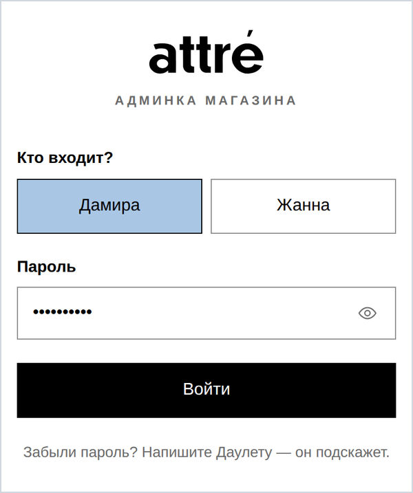

Телефон запомнит вход: пароль спросят снова примерно раз в три месяца (и если не заходить дольше месяца).
На чужом телефоне или компьютере после работы выйдите: на компьютере — «Выйти» вверху справа, рядом с вашим
именем; на телефоне — нажмите кружок с буквой вверху справа → «Выйти».

Пароль никому не пересылайте. Сменить его можно самой — как, написано чуть ниже. Забыли пароль — напишите
Даулету: он сбросит его и скажет, с каким войти (админка попросит войти заново на всех ваших устройствах —
это нормально).

### Сменить пароль

1. На телефоне нажмите кружок с буквой вверху справа, на компьютере — своё имя вверху справа.
2. Нажмите **«Сменить пароль»**.
3. В первое поле впишите пароль, с которым входите сейчас.
4. Во второе — новый пароль, не короче 8 символов. В третье — его же ещё раз, чтобы не ошибиться.
   Глазик справа в поле показывает, что вы набрали.
5. Нажмите **«Сменить пароль»**. Появится надпись «Пароль изменён». Телефон предложит сохранить новый пароль —
   соглашайтесь.

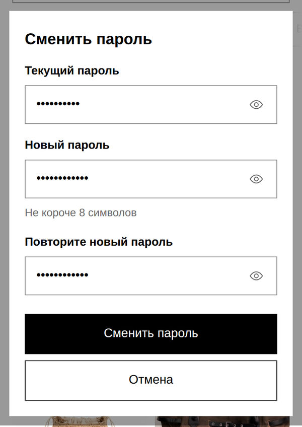

На этом телефоне (или компьютере) вы останетесь в админке. На других ваших устройствах админка напишет
«Пароль сменили — войдите с новым паролем» — вводите уже новый; если телефон сам подставит старый, сотрите его и
наберите новый. Вторую из вас это не касается: её пароль и вход не меняются.

Если что-то не так, админка подскажет красным прямо под полем. «Текущий пароль не подошёл» — проверьте раскладку
(русская или английская) и большие буквы, как при входе.

### Значок админки на экране телефона

Чтобы открывать админку одним нажатием, как приложение.

**iPhone** (в Safari):

1. Откройте админку в **Safari**.
2. Внизу экрана нажмите кнопку **«Поделиться»** — квадратик со стрелкой вверх ↑. Не видно её — сначала нажмите
   «•••» внизу, она там.
3. Откроется список. Пролистайте его вниз и нажмите **«На экран „Домой“»**.
4. Вверху справа нажмите **«Добавить»**. На экране телефона появится значок «Админка» — открывайте админку им.

**Android** (в Chrome):

1. Откройте админку.
2. Нажмите «⋮» вверху справа.
3. Выберите **«Добавить на главный экран»** (или «Установить приложение») → **«Добавить»**.

На компьютере просто добавьте страницу в закладки.

---

## 2. Что где в админке

* Вверху: **«attré · админка»** и две вкладки — **«Товары»** и **«Магазин и доставка»**. Справа на компьютере —
  **«Открыть сайт ↗»**, **«Как пользоваться»** (эта инструкция), ваше имя (нажмите — там «Сменить пароль») и
  «Выйти». На телефоне справа — **«Сайт ↗»** и кружок с буквой: нажмите на него — там «Как пользоваться»,
  «Сменить пароль» и «Выйти».
* Под шапкой — **полоса публикации**: видно, дошли ли ваши изменения до сайта
  (подробно — в разделе [13](#13-публикация-сколько-ждать)).
* **«Товары»** — все вещи карточками: главное фото, название, артикул и тип, цена, кружочки цветов и пометки
  «Скрыт», «Нет фото», «Продано», «Скоро», «Скидка −20 %», «Новинка», «Популярное». У вещи со скидкой старая цена
  зачёркнута, новая — красным.
  * Над списком — **«Изменить порядок»** и чёрная кнопка **«+ Добавить товар»**.
  * Поиск — по названию, артикулу или цвету («зебра», «молочный»). Название можно писать и по-русски:
    «токио» найдёт Tokyo, «копенгаген» — Copenhagen.
  * Кнопки-фильтры: Все · Сумки · Кардхолдеры · Брелоки · Скрытые · Без цены · Со скидкой · Скоро в наличии · Проданные
    (рядом с каждой — сколько там вещей). На телефоне они не помещаются в строку — листайте их пальцем вбок
    (правый край у них бледнеет).
  * Нажмите на карточку — откроется товар.

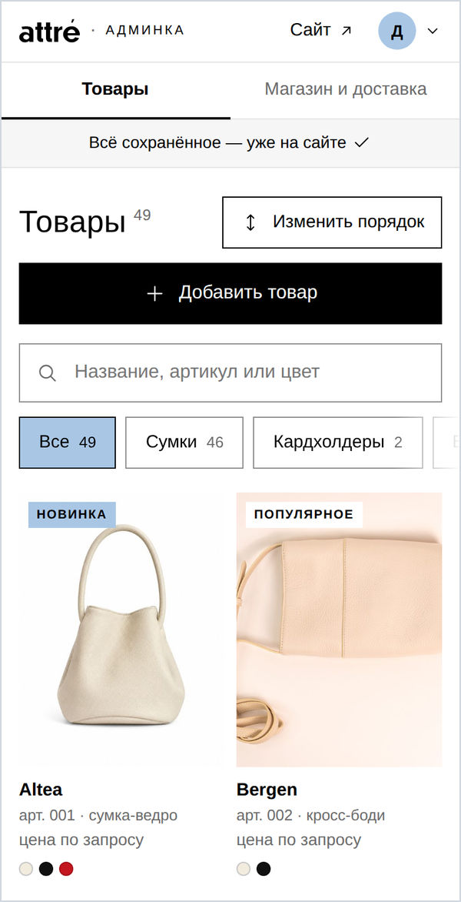

---

## 3. Новый товар — от начала до конца

**Шаг 1.** «Товары» → **«+ Добавить товар»**. Откроется пустой товар; «Показывать на сайте» уже включено.
Звёздочкой отмечено то, без чего сохранить нельзя, а серым «необязательно» — то, что можно пропустить.
Под названием товара — строка разделов «Основное · Цена и наличие · Цвета · Описание» (у «Цвета» в скобках —
сколько их): нажмите на раздел — страница сама к нему пролистается.

**Шаг 2. «Основное»**

* **Название*** — как на сайте, например «Altea».
* **Категория*** — нажмите нужную: «Сумки», «Кардхолдеры» или «Брелоки».
* **Тип** — какая это вещь. Под полем — знакомые типы: тоут, багет, хобо, боулер, сумка-ведро, шопер,
  кросс-боди… Нажмите подходящий. Начнёте писать — останутся только похожие (на картинке написали «сумка»).
  Нет подходящего — впишите свой. На сайте тип стоит под названием.
* **Артикул** — номер ставится сам после сохранения (например, 050) и больше не меняется. По нему покупатели
  спрашивают о вещи в WhatsApp.

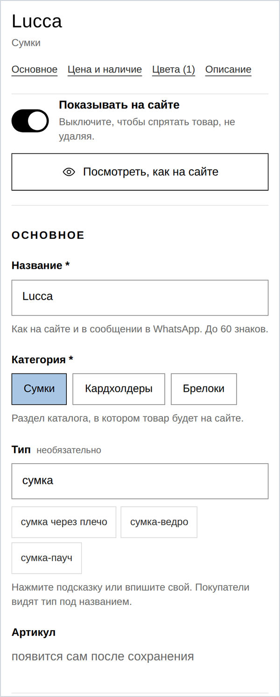

**Шаг 3. «Цена и наличие»** — сразу после «Основного»: это меняют чаще всего.

* **Цена** — только цифры, например 45000 (знак ₸ уже стоит в поле, пробел админка поставит сама). Оставите
  пустой — на сайте будет «цена по запросу».
* **Скидка** — если вещь продаётся дешевле обычной цены; обычно выключена (подробно — в разделе
  [6](#6-поменять-цену-или-наличие), «Скидка»).
* **Наличие** — «В наличии», «Скоро в наличии» или «Продано» (что это меняет — в разделе [6](#6-поменять-цену-или-наличие)).
* **Остаток** — сколько штук осталось, можно не заполнять (поле есть, только когда выбрано «В наличии»).
  Если поставить 1, на сайте появится пометка «остался 1».
* **Метки** — «Новинка» и «Популярное»: нажмите на квадратик, появится галочка
  (раздел [10](#10-новинка-и-популярное)).

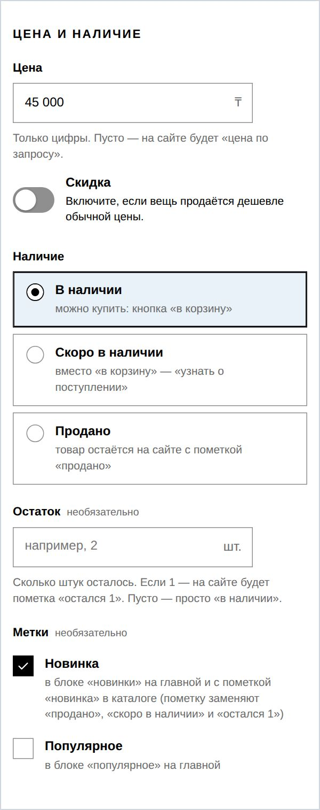

**Шаг 4. «Цвета и фото»** (подробно — в разделе [4](#4-цвета-и-фото))

1. Нажмите самый близкий кружочек цвета.
2. **«Название цвета на сайте» (необязательно)** — если хочется назвать цвет точнее, например «карамельный».
   Пусто — на сайте будет название кружочка («коричневый»).
3. **Материал** — кожа, замша, ворс, текстиль или эко-кожа (нажали не то — нажмите ещё раз, выбор снимется).
4. **«Добавить фото»** → выберите фото этого цвета, можно сразу несколько. Дождитесь, пока все загрузятся
   (большие фото телефон сначала уменьшает — на плитке «Готовим…», потом «Загрузка» с процентами).
5. Есть ещё цвета — **«+ Добавить цвет»** и то же самое для каждого.

**Шаг 5. «Описание и размеры»**

* **Описание** — пара предложений: какая вещь, с чем носить, что помещается.
* **Размер, см** — ширина × высота × глубина, три числа. Заполните все три:
  если хотя бы одного нет, на сайте будет «уточняется».
* **Ручки и ремни** — например, «съёмный ремень 120 см, ручка 20 см». На сайте это строка «ручки и ремни»
  в «характеристиках».
* **«Казахский и английский»** — свёрнутый блок в конце раздела, заполнять необязательно: нажмите на него —
  откроются те же тексты на казахском и английском. Пусто — на казахской и английской версиях сайта будет
  русский текст.
  Если потом поменяете русский текст, а перевод оставите прежним, под полем появится голубая подсказка
  «Вы поменяли русский текст, а казахский и английский остались прежними»: **«Поправить перевод»** откроет
  перевод, **«Убрать старый перевод (будет русский)»** сотрёт его — и на всех языках будет новый русский текст.

**Шаг 6. Посмотрите, как будет на сайте.** На компьютере превью **«Так будет на сайте»** справа,
на телефоне — кнопка **«Посмотреть, как на сайте»** вверху или **«Превью»** (значок-глаз) на нижней панели.
Сверху — карточка в каталоге, ниже — страница товара. Нажимайте на кружочки — фото меняются, как
у покупательницы. Рядом с карточкой — кадр «крупной» карточки: первая вещь в каталоге на телефоне
показывается крупно, и кадр у неё чуть обрезан сверху и снизу. Пока у товара нет фото, карточки в превью нет.
На картинке — превью готовой сумки Altea.

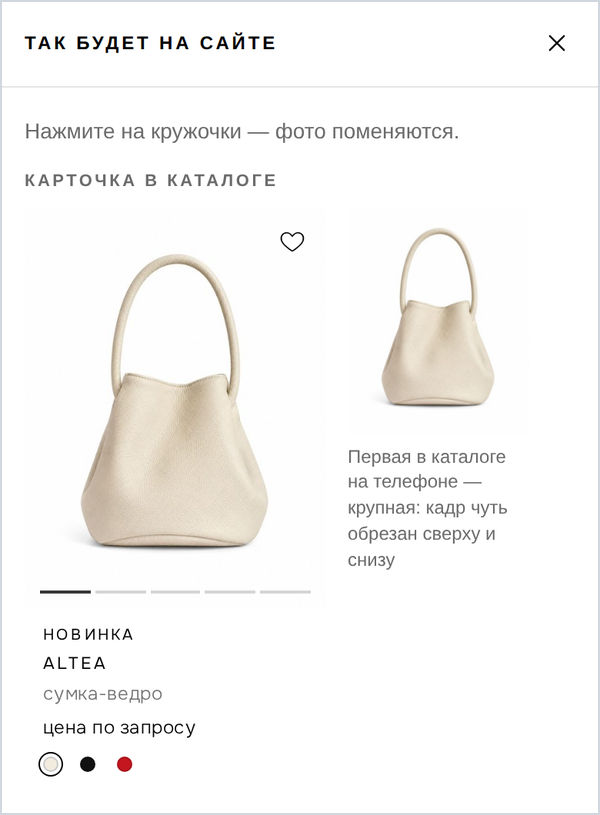

**Шаг 7. «Сохранить и опубликовать»** — чёрная кнопка внизу.

* Если что-то не заполнено, админка подсветит поле красным и внизу перечислит, что проверить
  («Проверьте: название, категорию, цвет, фото.»). Свёрнутый цвет с ошибкой раскроется сам.
* Пока идёт «Сохраняем…» (несколько секунд), поля не нажимаются — так ничего не потеряется.
* Всё в порядке — вверху появится «Сохранено. Публикуем на сайт… обычно 2–3 минуты». Через 2–3 минуты вещь
  на сайте, а там же появится «Опубликовано» и ссылка **«Открыть товар на сайте ↗»**.
* Новая вещь встаёт в каталоге первой. Хотите в другое место — [«Изменить порядок»](#9-порядок-товаров).

Кнопка рядом с «Сохранить и опубликовать» меняется сама: пока ничего не поменяли — **«Закрыть»** (вернуться
к списку), а когда есть правки — **«Отменить правки»** (товар станет таким, как был до них; админка переспросит).

**Если страница закрылась, а вы не сохранили.** Введённое не пропало: админка сутки хранит его в черновике
на этом телефоне (или компьютере). Откройте товар снова (новый — снова через «+ Добавить товар»): сверху будет
«Есть несохранённый…» и время. **«Восстановить»** вернёт введённое, **«Удалить черновик»** — забудет его.
На iPhone так бывает: Safari иногда сам перезагружает страницу после «Камеры» или «Фото», и ещё страница
обновляется, если потянуть её вниз.

---

## 4. Цвета и фото

**15 кружочков**: чёрный, синий, коричневый, бежевый, молочный, серый, красный, розовый, голубой, бордовый,
зелёный, жёлтый, леопардовый, коровий, зебра (принты нарисованы узором). По ним работает фильтр «цвет»
на сайте: покупательница выбирает «коричневый» — и видит все коричневые вещи. Поэтому кружочков немного и они
общие для всех вещей: выбирайте самый близкий, а точный оттенок напишите словами.

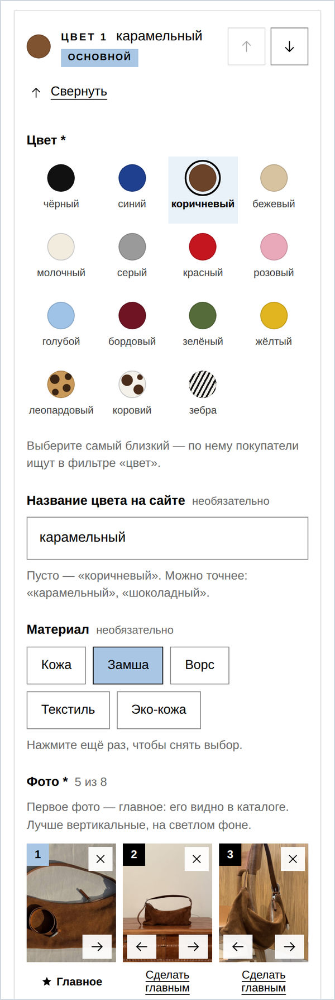

* **Название цвета на сайте.** Сумка «карамельная»? Выберите коричневый кружочек и напишите «карамельный»
  (как на картинке; с маленькой буквы, как остальные цвета на сайте). Покупательница увидит «цвет: карамельный»,
  а в фильтре вещь найдётся среди коричневых. Перевод названия — в блоке «Казахский и английский» в конце
  формы. Не написали название — на сайте будет название кружочка, а у него перевод уже есть.
* **Два оттенка одного цвета** (светло- и тёмно-коричневый) — можно: у обоих выберите коричневый, а у второго
  обязательно напишите своё название цвета, например «шоколадный», — иначе их не различить.
* **Основной цвет — первый** (с пометкой «основной»). Его фото стоит в каталоге и открывается первым
  на странице товара. Чтобы основным стал другой цвет, нажмите у него **«Сделать основным»** (или поднимите
  его стрелкой ↑).
* **У сохранённого товара цвета свёрнуты** в короткие строки: маленькое фото, кружочек, название цвета,
  «кожа · 4 фото» и **«Изменить»** — так до описания не нужно долго листать. «Изменить» раскрывает цвет
  целиком, **«Свернуть»** — снова в строку. Новый цвет и цвет с ошибкой открыты сразу.
* **Главное фото — первое** в каждом цвете (номер 1), под ним — «★ Главное». Поменять — «Сделать главным»
  под другим фото или стрелками ← и → на фото.
* **Нажмите на фото** — откроются все действия с ним крупно: сделать главным, сдвинуть, перенести в другой цвет
  (если фото попало не туда), удалить.
* **Сколько фото**: от 1 до 8 на каждый цвет — рядом со словом «Фото» видно, сколько уже, например «5 из 8».
  Ненужное — крестик ✕ в углу фото (админка переспросит). Фото пропадёт только после «Сохранить и опубликовать» —
  до этого «Отменить правки» внизу вернёт товар как был.
* **Файл не подошёл** (видео, документ, слишком большой) — на плитке «Не подошёл» и имя файла, а под словом
  «Фото» — почему: «Файл «IMG_2041.MOV» не подошёл. Это видео, а нужно фото.» Уберите такую плитку крестиком.
  Если фото не загрузилось из-за связи — на плитке «Не загрузилось» и кнопка «Повторить».
* **Убрать цвет целиком** — «Удалить этот цвет» (тоже переспросит). Хотя бы один цвет должен остаться.
* **На компьютере** фото можно просто перетащить мышкой в зону «Добавить фото».

**Как это выглядит на сайте**: в каталоге под ценой — кружочки цветов, нажатие показывает фото этого цвета.
На странице товара — кружочки под кнопкой «в корзину» и подпись «цвет: молочный». В корзину и в сообщение
в WhatsApp попадает тот цвет, который выбрала покупательница.

---

## 5. Как снимать, чтобы было красиво

* **Вертикально.** На сайте все фото стоят в вертикальной рамке 3:4 — держите телефон вертикально
  (на iPhone обычный режим «Фото» как раз такой).
* **Светлый ровный фон**: белая или светло-серая стена, лист ватмана, ткань без складок. На ровном фоне сайт
  не обрежет вещь, а аккуратно продлит фон; на пёстром — обрежет края.
* **Дневной свет** у окна, без вспышки и резких теней.
* **Вещь целиком**, по центру, с небольшим запасом по краям — чтобы ручки и ремень не обрезались.
* **3–5 фото на цвет**: спереди (это главное), сбоку, сзади, внутри, крупно фактура или застёжка.
  Хорошо, если одно фото — на человеке: виден размер.
* **Цвет как в жизни**: без фильтров — покупательница должна получить ту вещь, которую видела.
* **Все вещи в одном стиле** (один фон, один свет) — каталог смотрится дороже.
* Перед съёмкой протрите объектив.

Подходят обычные фото с телефона, в том числе с iPhone. Не подойдут видео и файлы больше 30 МБ.

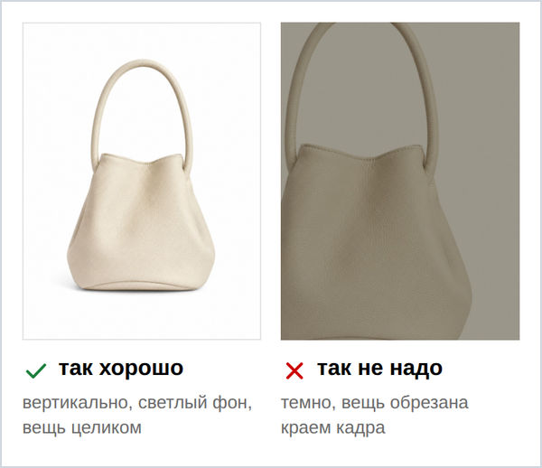

---

## 6. Поменять цену или наличие

1. «Товары» → найдите вещь: поиском сверху или фильтром («Без цены», «Скоро в наличии», «Проданные» и другие).
2. Нажмите на карточку.
3. В разделе **«Цена и наличие»** поменяйте цену или нажмите нужную кнопку наличия.
4. **«Сохранить и опубликовать»**.

Что видит покупательница:

| в админке | на сайте |
|---|---|
| «В наличии» | обычная кнопка «в корзину» |
| «Скоро в наличии» | пометка «скоро в наличии»; вместо «в корзину» — кнопка «узнать о поступлении» в WhatsApp |
| «Продано» | пометка «продано», вещь уходит в конец каталога и пропадает из «новинок» и «популярного»; вместо «в корзину» — «спросить о похожих». Страница остаётся: ссылки из Instagram по-прежнему открываются |
| остаток 1 | пометка «остался 1»; положить в корзину больше, чем осталось, нельзя |
| цена пустая | «цена по запросу» |
| скидка | старая цена зачёркнута, рядом новая — красным; в корзине и в сообщении в WhatsApp — цена со скидкой |

### Скидка

**Включить.** Откройте товар → «Цена и наличие». Проверьте, что **Цена** заполнена — скидка считается от неё.
Включите переключатель **«Скидка»** под ценой и нажмите **−10 %**, **−20 %** или **−30 %**: цена со скидкой
посчитается сама, без мелочи (45 990 ₸ −30 % — это 32 190 ₸). Можно вписать и свою цену. Рядом сразу видно,
сколько это в процентах: «скидка 20 %». **«Сохранить и опубликовать»**.

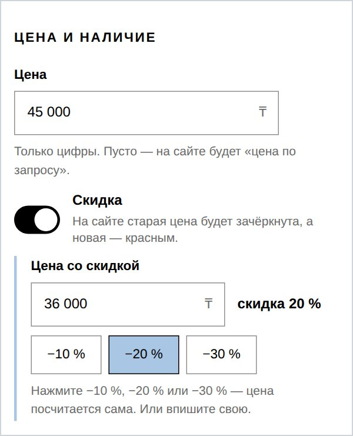

**Выключить.** Откройте товар → выключите **«Скидка»** → **«Сохранить и опубликовать»**: на сайте снова будет
обычная цена. Передумали до сохранения — включите «Скидка» обратно: цена со скидкой вернётся.

* Обычную цену не трогайте — она и есть та, что будет зачёркнута.
* Цена со скидкой должна быть меньше обычной — иначе админка подскажет красным и не сохранит.
* Все вещи со скидкой — «Товары» → фильтр **«Со скидкой»**; на карточке пометка «Скидка −20 %».

---

## 7. Скрыть товар

Если вещь пока не готова к показу (не решили с ценой, ждёте новые фото) или снята с продажи — её можно
спрятать, не удаляя.

1. Откройте товар.
2. Вверху выключите **«Показывать на сайте»**.
3. **«Сохранить и опубликовать»**.

Пока вы не сохранили, подсказка под переключателем напомнит: «После сохранения товар пропадёт с сайта (здесь
он останется)». После сохранения вверху появится «Сохранено. Убираем товар с сайта… обычно 2–3 минуты».
Вещь пропадёт с сайта, а в админке останется с пометкой «Скрыт» (фильтр «Скрытые»). Вернуть — включить
и снова сохранить.

**Скрыть или «Продано»?** Если вещь раскупили, лучше нажать «Продано»: страница останется, и по старой ссылке
покупательница увидит пометку и похожие вещи. Скрытая вещь исчезает с сайта совсем — ссылка на неё
перестанет открываться.

---

## 8. Удалить товар

1. Откройте товар и пролистайте в самый низ, до раздела «Удаление».
2. Нажмите кнопку **«Удалить товар»** (в красной рамке, со значком корзины).
3. Админка переспросит и напомнит, что фото тоже удалятся. Нажмите **«Удалить навсегда»** (красная рамка, внизу) —
   или **«Просто скрыть»**, если передумали удалять, или **«Не удалять»**.

Во всех окнах-вопросах админки верхняя чёрная кнопка — безопасная, с ней ничего не пропадёт («Не удалять»,
«Продолжить редактирование»). Кнопка, после которой что-то пропадёт, — внизу, в красной рамке.

Удаляйте только то, что точно не нужно, — например, случайно созданный дубль. Во всех остальных случаях
лучше [скрыть](#7-скрыть-товар). Удалили по ошибке — сразу напишите Даулету: он вернёт вещь вместе с фото.

---

## 9. Порядок товаров

1. «Товары» → **«Изменить порядок»**. Откроется «Порядок в каталоге» — все вещи списком.
2. Переставьте вещи кнопками-стрелками справа у вещи: **↑** — на одно место выше, **↓** — ниже,
   **стрелка с чертой над ней** — в самое начало. Или перетащите вещь за точки **⋮⋮** у правого края
   (пальцем или мышкой).
3. Внизу появится «Порядок изменён — не забудьте сохранить». Нажмите **«Сохранить порядок»**.
   Передумали — «Отмена», в каталоге останется прежний порядок.

Чем выше в списке, тем выше в каталоге на сайте. В том же порядке вещи стоят в лентах «новинки» и
«популярное» на главной. Новые вещи сами встают первыми, проданные сайт сам ставит в конец.

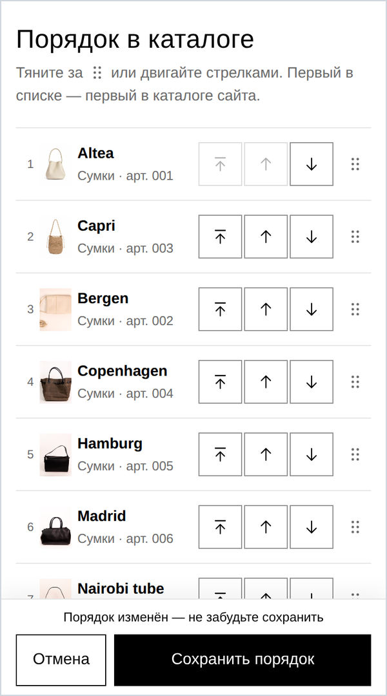

---

## 10. «Новинка» и «Популярное»

Это метки в разделе «Цена и наличие». Где их видно на сайте:

**«Новинка»**

* на главной — лента «новинки», сразу под большими фото;
* на карточке в каталоге — пометка «новинка»;
* в фильтре каталога — сортировка «сначала новинки».

Если ни одна вещь не отмечена, в ленте «новинки» сайт покажет первые шесть по порядку. Проданные в ленту
не попадают. На карточке видна одна пометка: «новинку» заменяют «продано», «скоро в наличии» и «остался 1».
Совет: держите в новинках 4–8 вещей и снимайте метку, когда вещь перестала быть новой.

**«Популярное»**

* на главной — лента «популярное», под новинками (если ни одна вещь не отмечена, ленты нет);
* в фильтре каталога — сортировка «сначала популярные».

Пометки «популярное» на карточке на сайте нет — она видна только вам, в админке.

---

## 11. Доставка и контакты

Вкладка **«Магазин и доставка»**. Блоки на ней идут сверху вниз: «Доставка по Казахстану», «Доставка по миру»,
«Контакты», «Полоса сверху сайта», «Продавец». Поменяли — внизу **«Сохранить и опубликовать»** (одна кнопка
на всю страницу). Передумали — **«Отменить правки»** рядом (пока ничего не поменяли, она бледная).
Несохранённое здесь тоже лежит в черновике, как у товара.

Переводы — как у товара: под текстами есть свёрнутый блок «Казахский и английский», пусто — на сайте будет
русский текст. Поменяли, например, часы работы только по-русски — появится та же голубая подсказка про перевод
(раздел [3](#3-новый-товар--от-начала-до-конца), шаг 5): поправьте перевод или уберите старый, иначе
на казахской и английской версиях останутся старые часы.

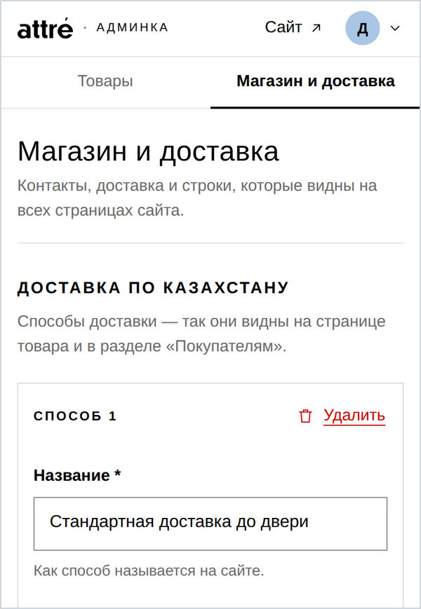

**«Доставка по Казахстану»**

* Способы доставки («Способ 1», «Способ 2»…): название («Стандартная доставка до двери»), цена в ₸, срок
  («2–3 рабочих дня»). Новый способ — **«+ Добавить способ доставки»**, лишний — «Удалить» у этого способа.
* **Бесплатный способ** — впишите цену 0: на сайте будет написано «бесплатно».
* Оставьте хотя бы один способ: если удалить все, на сайте останется старый общий текст о доставке.
* **«Бесплатная доставка от»** — сумма заказа, с которой доставка бесплатная. На сайте: «От 70 000 ₸ доставка
  по Казахстану бесплатная». Пусто — этой строки не будет.
* Ниже — голубой блок **«На сайте будет так»**: способы, цены и строка «бесплатно от» так, как их покажет
  сайт. Он меняется, пока вы печатаете.

**«Доставка по миру»** — поле «Текст для покупателей из других стран»: одна-две фразы, например «Стоимость
и сроки уточняйте у нас в WhatsApp.»

**«Контакты»**

* **WhatsApp** — номер, на который приходят все заказы из корзины и вопросы покупательниц: целиком, с кодом
  страны, например +7 706 723 23 49 (пробелы не мешают, 8 в начале админка сама заменит на +7). Проверьте дважды!
* **Instagram** и **Pinterest** — ник страницы, например attre.studio и attrestudio. Можно вставить и ссылку
  на страницу — админка сама оставит из неё ник.
* **E-mail** — почта магазина.
* **Ссылка на 2ГИС** — в приложении 2ГИС откройте магазин → «Поделиться» → скопируйте ссылку и вставьте сюда
  (она начинается с https://). На сайте это кнопка «открыть в 2ГИС».
* **Адрес магазина** — как он должен стоять на сайте, без точки в конце: «Алматы, ул. Кабанбай батыра, 96».
* **Часы работы** — целиком и без точки в конце: «Часы работы: 11:00–20:00».

Контакты видны на главной (блок «магазин в алматы»), внизу каждой страницы, на странице товара
и на странице «покупателям». Новый адрес и ник в Instagram сайт сам подставит и в тексты, где они
упомянуты: «Приходите посмотреть вживую…» на странице товара и «Отмечайте @attre.studio…» на главной.

**«Продавец»** — поля «ИП или ТОО с названием» («ИП …» или «ТОО «…»») и «ИИН или БИН» (12 цифр). Закон
требует, чтобы интернет-магазин показывал, кто продавец. На сайте это строка внизу страниц и в разделе
«покупателям → сведения о продавце»: «Продавец: ИП …, ИИН/БИН …» — её же покажет голубой блок «В подвале
сайта будет так». Пока не заполнены оба поля, строки нет.

---

## 12. Полоса сверху сайта

Чёрная полоса над шапкой на каждой странице сайта — сейчас там «Дарим 2 000 ₸ на первый заказ».

1. «Магазин и доставка» → блок **«Полоса сверху сайта»**.
2. В поле **«Текст полосы»** напишите новый текст (и, если есть, на казахском и английском). Чёрная полоска
   над полем сразу покажет, как это будет выглядеть.
3. **«Сохранить и опубликовать»**.

Пишите коротко: на телефоне в одну строку помещается около 40 знаков, длиннее — перенесётся на вторую.
Убрать полосу совсем нельзя, только поменять текст. Нажатие на полосу открывает описание бонуса на странице
«покупателям» — если акция поменялась, попросите Даулета поправить и тот текст.

---

## 13. Публикация: сколько ждать

После сохранения вещь появляется на сайте **через 2–3 минуты**. Ход публикации показывает полоса под шапкой:

| полоса | что значит |
|---|---|
| «Публикуем на сайт… обычно 2–3 минуты» | идёт публикация. Можно работать дальше или закрыть админку — публикация закончится сама |
| «Всё сохранённое — уже на сайте ✓» | готово: всё, что вы сохранили, на сайте. Если внизу формы «Есть несохранённые изменения» — их на сайте ещё нет, сначала сохраните |
| «Сайт не обновился. Ваши изменения сохранены — повторять не нужно. Сообщите Даулету» | сохранено, но сайт пока показывает прежний вариант. Напишите Даулету; вводить заново ничего не нужно |

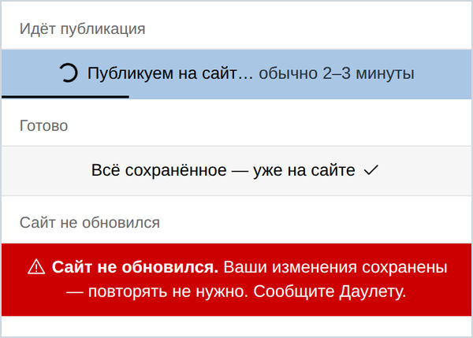

* Можно сохранить несколько вещей подряд, не дожидаясь: сайт покажет всё, когда закончится последняя публикация.
* Видите «✓», а на сайте по-старому? Телефон ещё несколько минут помнит прежнюю страницу — обновите её
  (потяните страницу вниз) через минуту-другую.

---

## 14. Если что-то пошло не так

* **Красная надпись у поля** — подсказка, что поправить: например, нет названия или фото. Исправьте
  и нажмите «Сохранить и опубликовать» ещё раз.
* **В сообщении написано «Сообщите Даулету»** — напишите ему (что написать — в конце раздела).
* **«Товар изменили в другом месте»** — значит, вторая из вас (или вы сами в другой вкладке) сохранила этот же
  товар раньше. Нажмите «Загрузить свежую версию»: откроется её вариант, а сверху — «Ваши несохранённые правки»
  списком. **«Вернуть мои правки»** поставит ваши изменения поверх её варианта (её правки в других полях
  останутся) — проверьте и сохраните. Можно и «Остаться и скопировать правки», если хочется сначала скопировать
  длинный текст.
* **«Есть несохранённый…»** при открытии товара — это черновик: вы что-то вводили и не сохранили (закрылась
  страница или телефон сам её перезагрузил). «Восстановить» или «Удалить черновик».
* **«Вход истёк»** — войдите снова: ваши изменения останутся на экране, потом ещё раз нажмите
  «Сохранить и опубликовать».
* **Пропал интернет или страница не отвечает** — пока не появилось «Сохранено», ничего не сохранилось.
  Не закрывайте страницу: дождитесь связи и нажмите кнопку ещё раз.
* **Фото не добавляется** — админка напишет почему. Обычно это видео или документ вместо фото, или файл
  больше 30 МБ. Выберите другое фото или переснимите. Если пишет, что фото не найдено, добавьте его заново.
* **«Пароль не подошёл»** — проверьте раскладку (русская или английская) и большие буквы. Недавно сменили
  пароль — вводите новый (если телефон подставил старый, сотрите его). После 10 неудачных попыток вход
  закрывается на 15 минут — для всех в той же сети Wi-Fi, даже если ошибались не вы. Если кто-то подбирает
  пароль, вход может закрыться на минуту для всех — просто подождите. Тем, кто уже вошёл, это не мешает
  работать, но сменить пароль в эти минуты тоже не получится: админка напишет «Слишком много неудачных
  попыток ввести пароль» и через сколько минут попробовать снова.

**Как написать Даулету**, чтобы он быстро помог: что вы делали, с какой вещью, снимок экрана и примерно когда
это было.

---

## 15. Частые вопросы

**Можно работать вдвоём одновременно?** Да. Только не правьте одну и ту же вещь в одно и то же время:
сохранится правка той, кто нажала «Сохранить» первой, а вторая увидит «Товар изменили в другом месте» (что
делать — в разделе [14](#14-если-что-то-пошло-не-так)).

**Где заказы?** Как и раньше, в WhatsApp: покупательница отправляет готовое сообщение из корзины.
В админке заказов нет.

**Вещь сохранена, а на сайте её нет.** Проверьте, что включено «Показывать на сайте», подождите 2–3 минуты
и обновите страницу сайта. Не появилась — напишите Даулету.

**У старой вещи все фото оказались в одном цвете.** Разложите их: «+ Добавить цвет» и выберите кружочек,
потом нажимайте на фото этого цвета в первом блоке → «Перенести в другой цвет» → новый цвет. Сохраните.

**Как поменять фото на главной или текст «о бренде»?** Пока через Даулета: в админке этого ещё нет.
